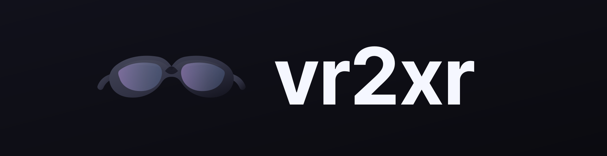
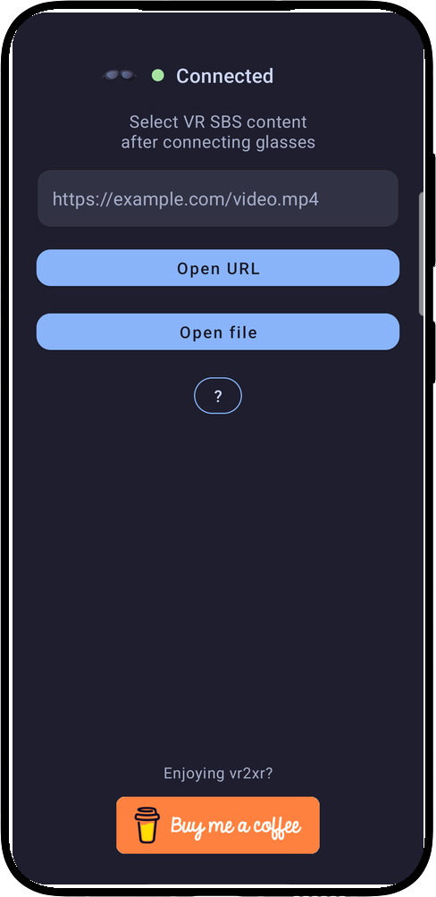
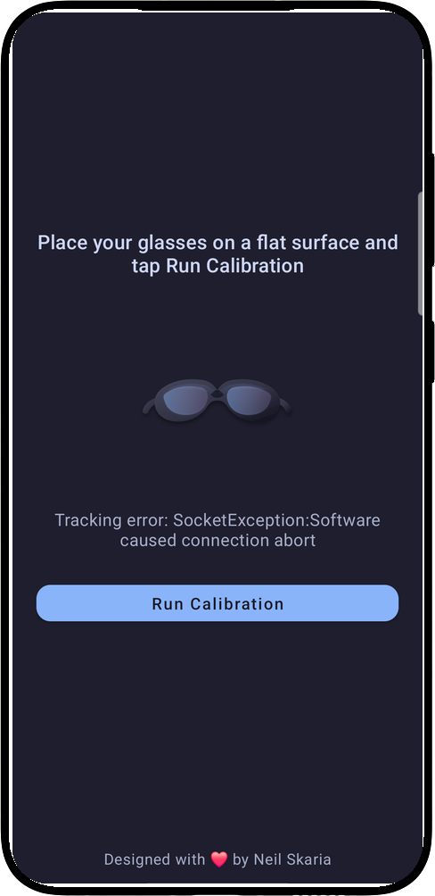
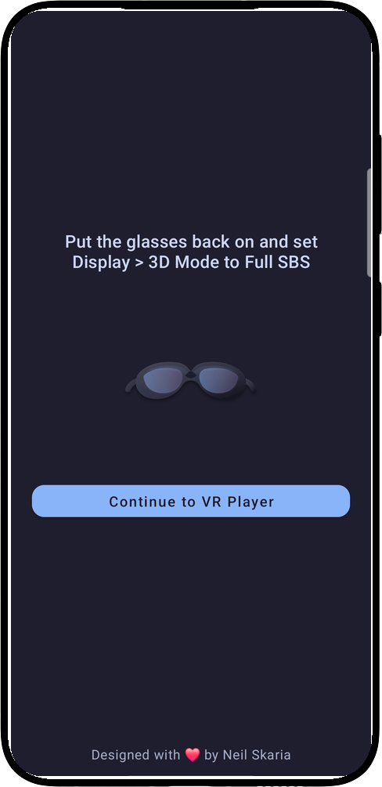
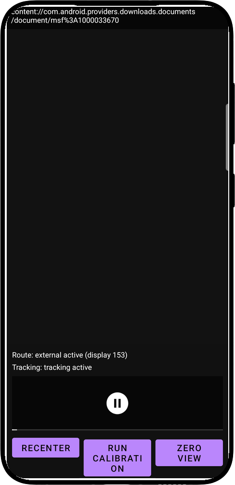
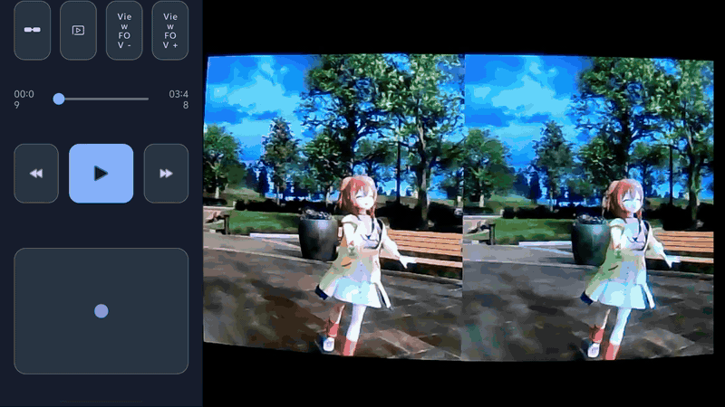
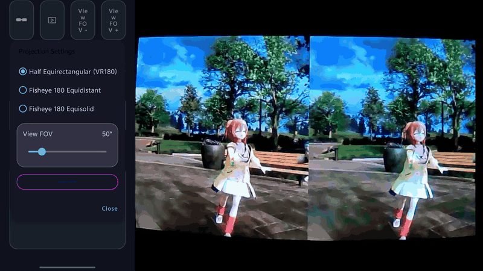
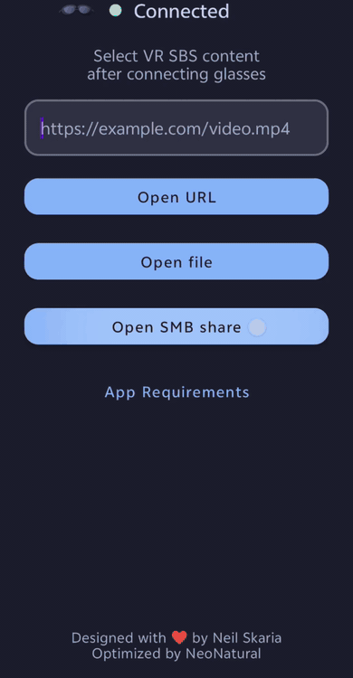

<p align="center">
  
</p>

<p align="center">
  <strong>English</strong> · <a href="README.zh-CN.md">简体中文</a>
</p>

## vr2sbs v0.2.4 release notes — faster SMB browsing, on-device cache, and smoother playback

This update makes SMB folders open quickly even with large libraries: video details are read in parallel and shown before thumbnails, both are remembered on the device, and a new home-screen control clears the cache. It also adds the sort menu and fixes two playback interruptions plus the lost folder position when returning from the player. IMU calibration now also works on devices that only configure the glasses' ECM USB link.

### New: video details under each SMB file name

- Every video row now shows a details line in a smaller font (13sp versus the 15sp file name), and the file name has moved up to make room.
- The details line shows resolution and duration (for example `3840×1920 · 12:34`) and, on a second line, file size and modified date (for example `1.2 GB · 2026-10-31`).
- Details for the whole folder are read in parallel, four files at a time, and each row updates as soon as its own information arrives. Thumbnails are only requested after this information pass finishes, so the details are visible first. Size and modified date come straight from the folder listing and appear immediately.
- Rotation metadata is applied, so portrait videos report the width and height you actually see. Fields that cannot be read are simply omitted.

### New: persistent SMB media cache

- Resolution, duration, size, modified date, and thumbnails are now saved on the device for each remembered SMB account and folder, so reopening the app or a folder no longer reads every file again.
- Each entry is validated against the file's current size and modified date from the folder listing. Unchanged files use the saved information and thumbnail immediately; a changed file is re-read and its entry replaced.
- Thumbnails are stored in app-private storage with a **128 MiB** total limit. When the limit is reached, the least recently used entries are removed automatically, so the cache never grows without bound.
- The launcher now has a **Clear SMB cache (used size)** button. It shows how much space the cache currently uses and clears it after confirmation; the next folder visit downloads the information and thumbnails again. Clearing the cache does not remove saved SMB accounts, sort order, or projection settings.

### Faster and more reliable thumbnails

- Metadata reads use a 64 KiB read-ahead buffer, so the many small reads made by `MediaMetadataRetriever` are served from far fewer SMB round trips.
- A thumbnail that fails because of a transient SMB error is retried, and a video whose preview frame at 1 second cannot be decoded falls back to its first frame.
- Thumbnails are kept in the persistent cache, so switching to the player and back no longer leaves rows blank while they reload.
- Queued previews for rows that have already scrolled off screen are skipped instead of blocking the previews you are looking at.

### New: sort menu replaces the fixed "Newest first" control

- The sort button now opens a **Sort by** dialog with five orders:
  - **Newest first** / **Oldest first** — by modified date, matching the previous behavior.
  - **Highest resolution**, **Longest duration**, and **Largest file size**.
- Folders always stay above videos. Videos with an unknown value sort last, then by name.
- The choice is saved and restored the next time the SMB browser opens.
- Resolution and duration require reading each file's metadata. When either is selected, the app reads the files that are not cached yet, shows `Reading video information… n/m` in the status line, then re-sorts once while keeping the current scroll position. Files that cannot be read are remembered so they are not retried in a loop; sorting by size or date needs no probing at all. With cached information, the correct order appears immediately.

### Fixes

- **Switching SBS output no longer pauses playback.** Rebuilding the glasses presentation briefly removes the video surface; the app now treats that moment as part of the output rebuild instead of as an output interruption, so playback keeps running and continues on the rebuilt presentation. A short settle guard also prevents the routing watchdog from tearing down a presentation whose surface is still attaching.
- **Slow-network buffering now shows a prompt.** If an SMB or HTTP source stays in buffering while playback should be running, a dialog explains that the connection is slower than the video needs and that playback will continue automatically. The prompt appears after 2.5 seconds when rebuffering during playback and after 8 seconds during the initial load. It closes automatically when playback recovers, and choosing **Keep waiting** does not make it reappear during the same stall.
- **Returning from the player keeps your place in the SMB folder.** The browser remembers the first visible item and its pixel offset, restores them after the list is rebuilt, and draws a blue outline around the file that was just played, scrolling it into view if it is off-screen. The same position preservation applies when changing the sort order.
- **IMU calibration works when Android only configures the glasses' ECM USB link.** XREAL One exposes two USB Ethernet functions: NCM, which Android normally configures at `169.254.2.1`, and ECM at `169.254.1.1`. Some devices only configure the ECM link, so the app previously connected to an address with no route and reported a calibration error. During calibration the app now inspects the IPv4 link-local routes and keeps `169.254.2.1` whenever that address is routable. It switches to `169.254.1.1` only when the default address has no route on any configured link. Devices that already calibrate normally therefore use exactly the same connection path as before.

### Installation and compatibility

- versionName `0.2.4`, versionCode `4`, minSdk 33, targetSdk 35.
- Supports XREAL One / XREAL One Pro.
- Upgrades in place over v0.2.3 (same signing identity); saved SMB profiles, sort order, and projection settings are kept.
- The first visit to each folder after upgrading reads its details and thumbnails again; later visits reuse the on-device cache. Cached media lives in the app's private storage and can be cleared from the launcher.
- Can be installed alongside the original vr2xr-neo app.
- The GitHub side-load APK is still signed with the Android Debug certificate; distributing through Google Play still requires a proper upload key and CI configuration.

---

## vr2sbs v0.2.3 release notes — major image-quality fix

**This is the most significant image-quality update in vr2sbs so far.** It fixes a long-standing defect where the glasses showed the right eye at roughly half the horizontal resolution of the left eye, while vertical resolution looked normal.

### Core fix: equal horizontal clarity in both eyes

- **Root cause.** The SBS fragment shader declared `precision mediump float`. On GPUs that implement `mediump` as fp16, texture coordinates in `[0.5, 1]` have half the precision of coordinates in `[0.25, 0.5)`. The right eye samples the right half of the source texture through a `+0.5` UV offset, so its horizontal sampling grid was about twice as coarse as the left eye's. Vertical UVs were identical for both eyes, which is why only horizontal resolution was affected.
- **Fix.** The shader now uses `highp` floats for texture coordinates when the GPU supports them (`GL_FRAGMENT_PRECISION_HIGH`), falling back to `mediump` otherwise. Both eyes now sample the source at the same precision.
- **Scope.** All projection modes, both Half-SBS and Full-SBS output, and all sources. Playback, SMB, tracking, and projection behavior are otherwise unchanged.

### Other changes since v0.2.2

- The launcher now has a **New Releases** button directly below **App Requirements**; it opens the GitHub Releases page.
- versionName is now `0.2.3` (versionCode `3`).

### Installation and compatibility

- versionName `0.2.3`, versionCode `3`, minSdk 33, targetSdk 35.
- Supports XREAL One / XREAL One Pro.
- Upgrades in place over v0.2.2 (same signing identity); saved SMB profiles and projection settings are kept.
- Can be installed alongside the original vr2xr-neo app.

### Notes

- The right-half lower-resolution issue listed under v0.2.2 is fixed in this release.
- The GitHub side-load APK is still signed with the Android Debug certificate used by v0.2.1 and v0.2.2; distributing through Google Play still requires a proper upload key and CI configuration.

---

## vr2sbs v0.2.2 release notes

This version adds LAN discovery for SMB shares, so opening a network folder works like Windows 11's **Network** view: scan for devices, pick one, sign in, and browse its shares without typing a share name. Existing SMB playback, projection, and tracking behavior is unchanged.

### New features

#### Scan SMB: discover servers on the local network

- A new **Scan SMB** button is available directly below **Open SMB share**.
- The scan starts automatically and lists SMB servers on the current Wi-Fi/Ethernet network as they are found. **Rescan** repeats the search.
- Servers are detected by probing TCP port 445 with bounded concurrency and a 450 ms timeout. Typical /24 networks are scanned in full (254 addresses); larger networks are limited to the local /24, while /23 or smaller subnets are scanned exactly. A scan targets at most 1,024 addresses.
- NetBIOS node-status queries resolve friendly names such as `MEDIA-PC`; the IP address is shown when a name is unavailable.
- The scan uses only the existing network permissions; no new runtime permission is required.

#### Device sign-in without a share name

- Tapping a discovered device opens the same credentials dialog used by **Open SMB share**: username, optional domain, password, and **Remember this account securely**.
- After a successful sign-in, the browser opens the device's share list directly, so no share name has to be entered.
- Administrative shares (`C$`, `ADMIN$`, `IPC$`, and similar) are hidden at the device root, matching the Windows **Network** view.
- Remembered devices appear at the top of the scan screen as purple buttons. Tap one to reconnect; long-press to forget all saved credentials for that device.
- Saved share-level accounts from older versions are grouped into one device entry per host, so they can be reused from the scan screen without signing in again.

### Fixes and improvements

- The **Share name** field in the manual **Open SMB share** form may now be left blank to list all shares on a server.
- Scan result and completion text handle singular and plural counts correctly.
- Added unit tests for subnet target selection, NetBIOS query/response encoding and parsing, and remembered-device grouping.

### Installation and compatibility

- versionName `0.2.2`, versionCode `2`, minSdk 33, targetSdk 35.
- Supports XREAL One / XREAL One Pro.
- Upgrades in place over v0.2.1 (same signing identity); saved SMB profiles are kept.
- Can be installed alongside the original vr2xr-neo app.

### Known issue

- On some sources the right half of the picture still looks lower-resolution on the glasses. This is under investigation; this version does not change the display/external output path. **Fixed in v0.2.3.**

---

## vr2sbs v0.2.1 release notes

This version is based on [NeoNatural/vr2xr-neo](https://github.com/NeoNatural/vr2xr-neo). It focuses on improving compatibility with SBS output devices, adjusting the default viewing FOV, and allowing IMU head tracking to be disabled when needed. Upstream features such as SMB2/SMB3 playback, VR180 fisheye projections, and touchpad view controls are unchanged and are not listed again.

### New features

#### Selectable SBS output (Half-SBS / Full-SBS)

- Projection Settings adds an **SBS Output** control.
- **Half-SBS**: outputs 1920×1080 (960×1080 per eye), for USB/adapter links that only support 1080p.
- **Full-SBS**: outputs 3840×1080 (1920×1080 per eye).
- Switching while playing automatically rebuilds the glasses output without leaving playback; the choice is saved automatically.

#### Half-SBS forced 1080p rendering

Even when the glasses report a 3840×1080 display mode, Half-SBS is rendered as a true half-width SBS frame at 1920×1080, so it is not mistaken for Full-SBS output.

#### Automatic external display-mode matching

The app selects a display mode with the same resolution as the chosen output format and prefers the current refresh rate, reducing visual jumps when switching formats.

#### Optional IMU tracking

- The calibration screen adds **Disable IMU Tracking**: when head tracking is not needed or calibration cannot be completed, calibration can be skipped and playback can start directly.
- The toggle is saved across screens and applies consistently in the launcher, SMB browser, and player.
- It can be re-enabled at any time in the player's glasses settings: calibration runs first, then playback resumes from the same source.
- With IMU disabled, **Recenter** resets the touchpad view offset.

#### Separate installation identity

- The app name is **vr2sbs**; the icon is unchanged.
- The applicationId is `com.vr2sbs`, so the app can be installed alongside the original vr2xr-neo without replacing it.

### Fixes and improvements

- Fixed unreadable text caused by the selected SBS option's text and background being the same color in Projection Settings.
- Unified the font size of Half-SBS, Full-SBS, and “Reset default FOV (58°)” with the other projection options.
- Renamed “Half Equirectangular (VR180)” to “VR180 to SBS” to match the new SBS output options.
- The default View FOV per playback is now 58° (previously 95°); during playback, real-time adjustment from 25° to 175°, 5° steps, pinch, drag, and double-tap recenter remain available.
- The current View FOV is preserved after the UI is recreated or rotated.
- Added/updated unit tests: SBS output format and display-mode selection, IMU tracking launch policy, and default FOV configuration.

### Installation and compatibility

- versionName `0.2.1`, versionCode `1`, minSdk 33, targetSdk 35.
- Supports XREAL One / XREAL One Pro.
- Can be installed alongside other vr2xr versions; each version stores its settings independently, and SMB profiles and projection settings from older versions are not migrated automatically.

### Known issue

- Some sources still appear to have lower resolution in the right half on the glasses. This is under investigation; this version does not change the related display/external output path.

**vr2sbs is an Android VR SBS video player for XREAL One and XREAL One Pro glasses.** It supports local files, HTTP(S) URLs, Android share intents, and SMB2/SMB3 network shares, with phone controls and IMU head tracking.

This repository is forked from [NeoNatural/vr2xr-neo](https://github.com/NeoNatural/vr2xr-neo), which continues [Skarian/vr2xr](https://github.com/skarian/vr2xr). It was renamed to vr2sbs and is maintained and optimized by [hywsaber](https://github.com/hywsaber). The original project and author are credited below; the fork-specific improvements are highlighted in [What this fork adds](#what-this-fork-adds).

## What this fork adds

> **This fork goes well beyond maintenance:** it adds high-performance network playback, two new VR180 projection models, faster FOV controls, and a more streamlined tracking workflow while preserving the original vr2xr playback experience.

- **Equal-resolution stereo rendering** — v0.2.3 fixes a fragment-shader precision bug that made the right eye sample at half the horizontal resolution of the left.
- **Native SMB2/SMB3 playback** — Browse network shares with thumbnails and sorting, then stream and seek through large videos using native `libsmb2`, with `jcifs-ng` as a compatibility fallback.
- **LAN SMB discovery** — Scan the local network for SMB servers, sign in once, and open a device's shares without typing a share name; remembered devices appear as quick-connect buttons.
- **Broader VR180 format support** — Play half-equirectangular, equidistant-fisheye, and equisolid-fisheye content, with independent view and lens FOV tuning.
- **Faster view control** — Drag directly to adjust the view, pinch with two fingers to change FOV, use dedicated 5° FOV buttons, and double-tap to recenter.
- **Smoother setup flow** — Enter calibration only when tracking requires it, launch calibration automatically after connection, and optionally hide the recurring Full SBS reminder.
- **Security and maintainability** — Encrypt saved SMB passwords with Android Keystore, document bundled dependencies and privacy behavior, and cover the new policies with unit tests.

### Detailed changes from the original project

The comparison baseline is the upstream `main` branch at [`52673c5`](https://github.com/skarian/vr2xr/commit/52673c58b376c96a19426bf2a1cff24bd0484685).

| Area | Changes in this fork |
| --- | --- |
| Video sources | Added an in-app SMB2/SMB3 entry point and network-share browser. Local files continue to use Android's system document picker. |
| SMB browsing | Added server/share/domain/account login, folder navigation, supported-video filtering, thumbnails, newest/oldest sorting, saved profiles, and profile removal. Added automatic LAN discovery with NetBIOS names and device-level sign-in without a share name. |
| SMB playback | Added a Media3 SMB data source with buffered random access for playback and seeking. Native `libsmb2` is preferred for throughput; `jcifs-ng` is retained as a fallback. |
| Credential privacy | Saved SMB passwords are encrypted with AES-GCM using a non-exportable Android Keystore key. Server metadata stays in the app's private storage. |
| Projection modes | Added VR180 fisheye equidistant and fisheye equisolid rendering in addition to the original half-equirectangular mode. |
| Projection controls | Added a fisheye lens-FOV control (`160°–220°`), expanded view-FOV control (`25°–175°`), fixed slider stepping, and persisted projection settings. |
| Touchpad controls | Replaced continuous edge auto-drag with direct drag plus two-finger pinch-to-change-FOV. Added `FOV -` / `FOV +` buttons with 5° steps; double-tap recenters the view. |
| Tracking flow | Calibration is opened automatically after glasses connect when no tracking stream exists. A selected video proceeds through calibration only when required, then to the Full SBS reminder. |
| SBS reminder | Added a **Do not show this again** option for the Full SBS readiness screen. |
| Launcher and player UI | Added the SMB action, changed requirements help to a labeled button, reorganized player controls, and updated project attribution in the app. |
| Maintenance | Added unit coverage for tracking launch policy, SMB browsing/playback policy, and projection configuration; documented bundled third-party SMB components and privacy behavior. |

---

<p align="center">
  
  &nbsp;
  
  &nbsp;
  
  &nbsp;
  
</p>

## Features

- **XREAL One support**: Live head tracking, connection status, factory bias correction, recalibration, adjustable IMU sensitivity, and an IMU tracking toggle that can skip calibration when disabled
- **Multiple video sources**: Local files, `http(s)` URLs, Android share intents, and built-in SMB2/SMB3 network shares
- **SMB media browser**: Browse folders, show video thumbnails, sort by modification date, and remember multiple server profiles
- **SMB device discovery**: Scan the local Wi-Fi/Ethernet network for SMB servers, resolve NetBIOS names, and open a device's shares without entering a share name
- **High-throughput SMB playback**: Native `libsmb2` random-access reading and seeking, with a `jcifs-ng` compatibility fallback
- **Multiple VR180 projections**: VR180 to SBS (half equirectangular), fisheye equidistant, and fisheye equisolid projection
- **SBS output options**: Switch between Half-SBS (1920×1080) and Full-SBS (3840×1080) output while playing
- **Live projection tuning**: Change view FOV and fisheye lens FOV while playing; the projection mode and SBS output format are remembered, and the view FOV starts at 58° for each playback
- **Phone playback controls**: Play/pause, 15-second seek, timeline scrubbing, projection controls, and a touchpad for view adjustment
- **Guided tracking setup**: Automatic calibration entry when needed, followed by an optional Full SBS reminder
- **Durable playback sessions**: Playback pauses when glasses output disappears and can resume after the output returns

## Requirements

- XREAL One or XREAL One Pro glasses
- Android 13 or newer (`minSdk = 33`)
- Samsung DeX desktop mode is not supported; use screen mirroring instead
- The app installs as **vr2sbs** (`com.vr2sbs`) and can be installed alongside the original vr2xr-neo app

Phone-only playback is intentionally unsupported. The app does not switch the glasses into SBS mode; that setting remains under user/device control.

## App guide

1. Connect the XREAL One or XREAL One Pro glasses.
2. Select a source:
   - tap **Open file** for Android's system file picker;
   - enter an `http(s)` URL and tap **Open URL**;
   - tap **Open SMB share** for a network share;
   - tap **Scan SMB** to discover SMB devices on the local network and sign in to one; or
   - share a video link/file to vr2sbs from another Android app.
3. If calibration is required, place the glasses on a flat surface and tap **Run Calibration**. If head tracking is not needed, tap **Disable IMU Tracking** to skip calibration.
4. Put the glasses back on and set `Display > 3D Mode` to match the app's **SBS Output** setting (`Full SBS` or `Half SBS`). The reminder can be hidden for future launches.
5. Tap **Continue to VR Player**. The app applies Zero View automatically.
6. Use the phone controls to play, pause, seek, adjust projection, and change the view.

If the glasses are disconnected during playback, the video pauses and waits for the glasses output to return.

## Player controls

- **Single-finger drag**: Adjust yaw and pitch
- **Two-finger pinch**: Change the view FOV continuously
- **Double-tap**: Recenter the view
- **FOV - / FOV +**: Change view FOV in 5° steps
- **Glasses settings**: Recalibrate, change IMU sensitivity, or disable/enable IMU tracking (re-enabling runs calibration first)
- **Projection settings**: Select the projection model and tune view/lens FOV
- **Playback row**: Seek backward/forward 15 seconds, play/pause, or scrub the timeline

<p align="center">
  
  &nbsp;
  
</p>

## SMB shares

For a share you already know, tap **Open SMB share** and enter the server host/IP and, optionally, a share name; domain, username, and password are available for authenticated shares. Leaving the share name blank lists all shares on the server.

To discover servers instead, tap **Scan SMB**: the app scans the current Wi-Fi/Ethernet network and lists SMB devices as they respond, showing NetBIOS names when available. Tap a device, enter the username and password (plus an optional domain), and the app opens the device's share list directly — no share name needed. Enable **Remember this account securely** to save the device; remembered devices appear at the top of the scan screen and can be removed with a long-press.

The browser shows folders and supported videos, generates thumbnails when possible, and can sort entries newest-first or oldest-first. Video data is read directly from the SMB server and is not copied to the developer or an intermediary service.

<p align="center">
  
</p>

## Build and test

Clone with submodules, or initialize them after cloning:

```bash
git submodule update --init --recursive
```

Use JDK 17 plus the Android SDK/NDK configured by the project, then run:

```bash
./gradlew testDebugUnitTest
./gradlew assembleDebug
```

The debug APK is generated under `app/build/outputs/apk/debug/`. More development details are in [`CONTRIBUTING.md`](CONTRIBUTING.md).

## Privacy and third-party components

- See [`PRIVACY_POLICY.md`](PRIVACY_POLICY.md) for local data and SMB credential handling.
- See [`THIRD_PARTY_NOTICES.md`](THIRD_PARTY_NOTICES.md) for the bundled `libsmb2` source and the `jcifs-ng` dependency.
- `libsmb2` is distributed under LGPL-2.1-or-later; the rest of the project remains subject to the licenses in this repository.

## Credits

vr2xr was created by [Neil Skaria](https://github.com/skarian). This fork started from [NeoNatural](https://github.com/NeoNatural)'s modifications, was renamed to vr2sbs, and is maintained and optimized by [hywsaber](https://github.com/hywsaber).

See the original project at [Skarian/vr2xr](https://github.com/skarian/vr2xr), the upstream fork at [NeoNatural/vr2xr-neo](https://github.com/NeoNatural/vr2xr-neo), and this fork at [hywsaber/vr2sbs](https://github.com/hywsaber/vr2sbs).
